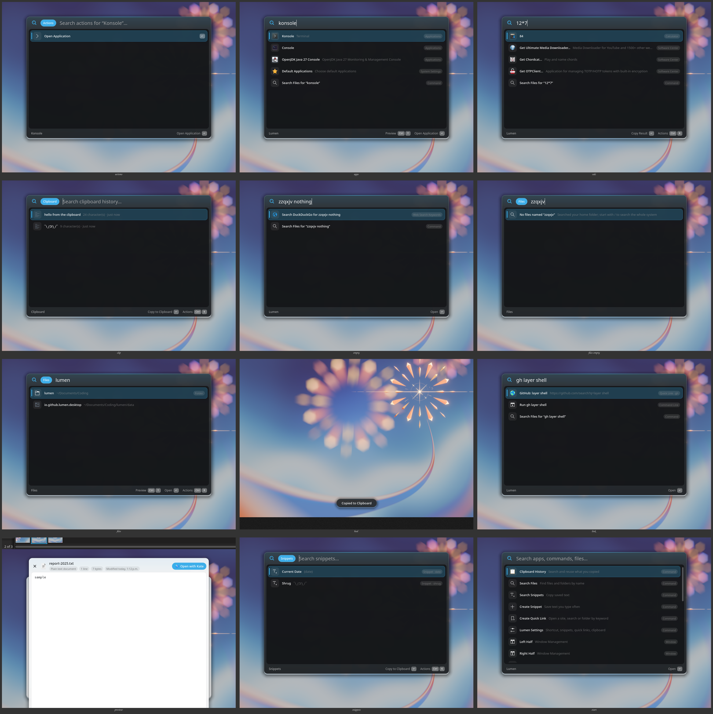

# Lumen

A fast, keyboard-driven launcher for KDE Plasma. Press **Meta+Space**, type,
press **Enter**.



## What it does

**Search and launch**
- **Apps, windows, System Settings pages, power and session commands,
  bookmarks, web shortcuts, calculations, unit and currency conversion**, from
  KRunner's plugins, the same ones Plasma's search uses (System Settings →
  Search → Plasma Search). Misspelt app names are found too (`firfox`).
- **Instant answers**: time zones (`time in tokyo`, `3pm india in edmonton`,
  `9am pst to cet`), dates (`days until christmas`, `in 3 weeks`,
  `100 days ago`, `next friday`, `week number`) and colours (`#ff8800`,
  `rgb(…)`, `hsl(…)`, with a swatch and copy in each format).
- **System**: Wi-Fi, Bluetooth, Do Not Disturb, dark/light colours (your own
  schemes are remembered), volume (`volume 40`, up, down, mute), ejecting
  drives; screen brightness comes from KRunner (`screen brightness 50`).
- **Media**: play/pause, next, previous for any player; what is playing is
  shown first on the start screen.
- **Screenshots and recording** (Spectacle) and **Pick Colour** (KWin).
- **Window layouts**: halves, quarters, thirds, two thirds, center, maximize,
  almost maximize, for the window you were using.

**Time and info**
- **Timers and Pomodoro**: `timer 10m tea`, `5 min timer`, `pomodoro` (25 min
  focus, 5 min breaks, a long break every fourth round). A countdown sits in
  the top-right corner; when one ends a notification with the alarm sound
  stays until dismissed. `timers` lists them (pause, +5 min, stop).
- **Reminders**: `remind me in 20 min to call mom`, `remind me at 5pm to
  leave`, `remind me tomorrow at 9 to send the report`. They survive restarts;
  one that came due while Lumen was not running is shown at start-up.
- **Calendar agenda**: add your calendars' iCal addresses (or .ics files) in
  Settings → Calendar & Weather; `agenda`, `today`, `meetings` or an event's
  name list what is coming. The next event (within 3 hours) leads the start
  screen, with **Join Meeting** for Meet/Zoom/Teams/Jitsi/Webex links.
- **Weather**: `weather`, `weather tokyo`, `tokyo weather` — now and the next
  three days, from Open-Meteo (free, no account). Your place defaults to your
  time zone's city; set it and the units in the settings.

**Developer tools**
- **Text transforms**: `upper some text`, `base64 hello`, `json {…}`, or a
  transform's word alone (`slug`, `camel`, `sort`) for the clipboard;
  **Transform Clipboard** shows every transform with a preview. Case styles,
  trim, join/sort/unique/reverse lines, Base64, URL and HTML encoding, JSON
  pretty/minify; `count` gives words/characters/lines.
- **Generators**: `uuid`, `password 24`, `pin 6`, `random 1-100`, `dice`,
  `lorem 3`, `sha256 text` (also md5, sha1, sha512), `timestamp`, and a Unix
  time (`1793817403`) read as a date.
- **Projects**: git repositories in your code folders (`~/Documents/Coding`,
  `~/Projects`, `~/src`, …) with their branch; Enter opens one in your editor
  (VS Code, VSCodium, Zed or Kate), Ctrl+T in Konsole. `projects` lists all.
- **SSH hosts** from `~/.ssh/config` (and readable `known_hosts`): Enter
  connects in Konsole. `ssh` lists all.

**Desktop control**
- **Sound**: switch the output (`headphones`, `speakers`, `output`, a device
  name) or the microphone (`mic`).
- **Bluetooth**: connect or disconnect paired devices by name.
- **Wi-Fi**: `wifi` lists nearby networks; saved ones connect at once, for a
  new secured one Lumen asks for the password (handed to NetworkManager over
  D-Bus, never on a command line).
- **App hotkeys**: Ctrl+Shift+H on an app, then press keys (e.g. Meta+F): the
  app comes to the front, starts if it is not running, or minimizes if it is
  already in front. They also appear in System Settings → Shortcuts → Lumen.

**Screen, files and system**
- **Copy Text from Screen** (`ocr`): select an area; Tesseract reads it.
  Needs language data: `sudo pacman -S tesseract-data-eng` (other languages:
  lumenrc `[OCR] Languages=eng+deu`).
- **QR codes**: `qr TEXT` (or `qr` for the clipboard) makes one (Space to
  view, copy as an image, save to Pictures); **Scan QR Code** reads one from
  the screen and opens a link or copies the text.
- **System**: `system`, `cpu`, `memory`, `disk`, `temperature`, `battery`,
  `uptime` cards; **Processes** lists the busiest programs with Quit and
  Force Quit.
- **Downloads**: `downloads` (newest first, with a preview; move to
  Documents/Pictures/Desktop) and `latest download`. File results can be
  dragged out of Lumen into other apps.

**Windows and focus**
- **Window commands**: halves, quarters, thirds, maximize, centre, plus
  Reasonable Size, Make Window Larger / Smaller, Restore Previous Size (undoes
  the last move Lumen made), Move to Next / Previous Screen, Move to Next /
  Previous Desktop, Move Window to Desktop N, Toggle Full Screen, Toggle
  Always on Top.
- **Window layouts**: **Save Window Layout** names the arrangement of the
  current desktop (which apps, where); typing the name (`coding`) puts it back,
  starting apps that are not running and placing them once they open.
- **Search Menu Items**: every command in the menu of the app you were using
  (`File › Save As…`), with its shortcut; Enter runs it. Apps share their
  menus while Plasma's global menu is on: add the application menu button to
  the titlebar (System Settings → Window Decorations → Titlebar Buttons) or the
  Global Menu widget to a panel.
- **Focus sessions**: `focus` starts one (how long, and a goal). Distracting
  apps and sites (Settings → Focus) are minimized whenever they come up,
  notifications wait (Do Not Disturb), and the countdown shows in the corner.

**Browser**
- **Browser history**: pages you visited in Firefox (and LibreWolf, Zen,
  Floorp, Waterfox) and Chrome, Chromium, Brave, Vivaldi, Edge and Opera appear
  in the search, read from the browsers' own history files (no extension
  needed); **Browser History** lists them newest first.
- **Search Browser Tabs**: switch to an open tab, through the Plasma Browser
  Integration extension (install it in your browser).

**Calculations**
- Percentages in words: `15% of 80`, `80 + 15%`, `15% off 80`,
  `12 is what % of 80`, `80 to 92 in %` (KRunner's calculator and unit
  converter do the rest: `3 ft in cm`, `sqrt(2)*pi`).
- **Calculator History**: the calculations and conversions you used, to copy
  again or calculate again (Ctrl+E).

**Views** (each also has a global shortcut slot, see below)
- **Search Files**: your home folder, live (with `fd`); start with `/` to
  search the whole system (`plocate`). Opens on your recently used files. A
  preview of the selected file is shown beside the list.
- **Clipboard History**: text and images you copied, searchable, pinnable,
  with a preview. Content that password managers mark secret is never stored.
  Images are found by the text in them (Tesseract reads them in the
  background; needs `tesseract-data-eng`).
- **Paste Stack**: copy several things, then paste them in order with
  Ctrl+Alt+V (a shortcut that exists only while the stack does); Ctrl+Shift+S
  in the clipboard history adds an item.
- **Paste as Plain Text**: pastes what is copied without its formatting (a
  global shortcut slot too).
- **Output** of script commands and extensions, line by line, with the whole
  text beside it.
- **Snippets**: saved text with placeholders: `{date}`, `{time}`,
  `{datetime}`, `{day}`, `{uuid}`, `{clipboard}` (`{clipboard offset=1}` is
  the item before); dates move and take a format: `{date +3d}`,
  `{time -2h}`, `{date +1M format="yyyy-MM-dd"}`; `{cursor}` is where the
  cursor ends up; `{argument name="who"}` is asked for when the snippet is
  used (also when it is typed in another app).
- **Emoji**: search emoji and symbols by name and keyword.
- **Switch Window**: every open window with a live thumbnail; switch, close
  (Ctrl+W) or minimize (Ctrl+M).
- **Notes**: a floating scratchpad that saves as you type.

**Make it yours**
- **Paste directly**: Enter on a clipboard item, snippet or emoji pastes it
  into the app you were using; Ctrl+Enter only copies. (Terminals paste with
  Ctrl+Shift+V: copy and paste there yourself, or turn pasting off in the
  settings.)
- **Snippets expand anywhere**: type `;` and a snippet's keyword in any app
  (`;addr`) and it is replaced by the snippet. This needs the expansion helper
  (see *Snippet expansion* below); the trigger character is set in Settings →
  Snippets.
- **Quick links**: open a site, search or folder by keyword: with keyword
  `gh`, `gh layer shell` searches GitHub.
- **Custom commands** (Settings → Commands): shell commands with a name and
  keyword; `{query}` becomes the quoted text typed after the keyword. Their
  output can be ignored, shown, copied, pasted, or listed as results.
- **Arguments**: commands, quick links and snippets that need several values
  use `{argument name="to"}` (also `default="…"`, `options="a,b,c"` for a
  choice). Lumen asks for them in fields beside the search: Tab moves between
  them, Enter runs.
- **Raycast script commands**: scripts written for Raycast
  (github.com/raycast/script-commands) run as they are, from
  `~/.config/lumen/script-commands/` or folders added in Settings → Commands.
- **Extensions**: programs in `~/.config/lumen/extensions/` (format below),
  with lists of their own, details, several actions and nested lists.
- **Fallback commands** (Settings → General): what the search offers for any
  text, below the results ("Search Files for …", a quick link, a command);
  Ctrl+K → Use as Fallback adds one.
- **Themes**: System, Light, Dark, Midnight, Paper, Mocha or Forest, with any
  accent colour (Settings → General, or **Lumen Theme**).
- **Favourites** (Ctrl+D on a result) appear on the start screen; **aliases**
  (Ctrl+Shift+A) bring up a result with a word of your choice (`ff` →
  Firefox).
- **Sync folder** (Settings → General): keep snippets, quick links, commands,
  favourites, aliases and notes in a folder synced between computers
  (Syncthing, Resilio, Nextcloud); changes from another computer are picked up
  at once.

## Keys

| Key | Does |
| --- | --- |
| Meta+Space | open / close Lumen (changeable) |
| ↑ ↓, Page Up/Down | move through results |
| Enter | run the selected result |
| Ctrl+Enter | the second action (copy instead of paste, show in folder, …) |
| Tab | complete the search to the selected result's name |
| Space | preview the selected file once you have moved to it with the arrow keys; Space again closes the preview, which follows the arrow keys while open |
| Ctrl+Y | preview the selected file, also while typing |
| Ctrl+K | all actions for the selected result |
| Ctrl+D | add to / remove from favourites |
| Ctrl+Shift+A | set an alias |
| Ctrl+Shift+H | give an app a global hotkey |
| Ctrl+[ / Ctrl+] | back / forward between views |
| Esc | close the preview, the actions, the current view (one level), then Lumen |
| Backspace in an empty field | back one view |
| Ctrl+Alt+V | paste the next item of the paste stack (only while there is one) |

Reopened within 90 seconds (Settings → General), Lumen comes back to where it
was, with the text selected; after running something it starts afresh.

Clipboard History, Search Files, Search Snippets, Search Emoji, Switch Window,
Search Menu Items, Search Browser Tabs, Paste as Plain Text and Notes can get
their own global shortcuts (none by default) in System
Settings → Keyboard → Shortcuts → Lumen.

## Command line

```
lumen                     start in the background
lumen --toggle            show or hide
lumen --show TEXT         show with TEXT typed
lumen --view NAME [TEXT]  open a view: clipboard, files, snippets, emoji, windows, notes,
                          transform, processes, downloads, paste-stack, menu, tabs,
                          history, calculations, theme
lumen --settings          settings window
lumen --tile left-half    move the active window (every command id: lumen --help;
                          "restore" undoes the last one)
```

## Extensions

An extension is any executable in `~/.config/lumen/extensions/`. Lumen runs
`EXT info` once (and again when the folder changes), expecting:

```json
{"name": "Packages", "keyword": "pkg", "description": "…", "icon": "package",
 "placeholder": "Search packages…", "preview": true, "mode": "list",
 "arguments": [{"name": "repo", "placeholder": "Repository", "optional": true,
                "options": ["core", "extra"]}]}
```

Only `name` is required. In **list** mode (the default) Enter opens the
extension's own view: Lumen runs `EXT search TEXT [--arg NAME=VALUE …]` as
you type and shows the JSON array it prints. Without arguments, typing the
keyword and a space also shows its results in the main search. Each result:

```json
{"title": "…", "subtitle": "…", "icon": "name, path or emoji", "accessory": "…",
 "detail": "Markdown shown beside the list (with \"preview\": true)",
 "copy": "text",
 "actions": [{"title": "Open Homepage", "open": "https://…", "shortcut": "Ctrl+O"},
             {"title": "Versions", "push": "versions-of-firefox"}]}
```

The result's own `open` (URL or path), `copy`, `paste` or
`run: [program, args…]` is its first action; `actions` adds more (listed
with Ctrl+K). `push: ID` opens a nested list: Lumen runs `EXT open ID TEXT`
and shows what it prints, and Esc comes back.

In **run** mode Enter asks for the arguments, runs
`EXT run --arg NAME=VALUE …`, and uses what it prints: plain text (one line
is shown as a message, more lines open the output view) or a JSON object
with one of `message`, `copy`, `paste`, `open`, `text` (output view) or
`detail` (Markdown).

`examples/extensions/packages` searches installed packages (`pkg firefox`).

## Raycast script commands

Scripts with Raycast's metadata comments run as they do in Raycast:

```sh
#!/bin/bash
# @raycast.schemaVersion 1
# @raycast.title Say Hello
# @raycast.mode compact
# @raycast.packageName Greetings
# @raycast.icon 👋
# @raycast.argument1 { "type": "text", "placeholder": "Name" }
echo "Hello $1"
```

Lumen reads them from `~/.config/lumen/script-commands/` and any folder added
in Settings → Commands (files named `*.template.*` are skipped, as in Raycast).
Supported: `title`, `mode` (`silent`: runs with Lumen closed, the last line is
shown; `compact`: the last line; `fullOutput`: the output view;
`inline`: the first line under the title, refreshed every `refreshTime`),
`packageName`, `icon`/`iconDark` (emoji or file), `description`,
`currentDirectoryPath`, `needsConfirmation`, and up to three arguments
(`text`, `password`, `dropdown` with `data`; `optional`, `percentEncoded`).
Scripts need not be executable: their first line names the interpreter.
`examples/script-commands/local-ip.sh` shows your local address inline.

## Snippet expansion

Wayland does not let an application see what is typed in other windows, so
expanding `;addr` in any app needs `lumen-expand-helper`, a small system
service (`helper/`) that reads the keyboards itself:

```sh
sudo helper/install-helper.sh              # after ./install.sh has built Lumen
sudo helper/install-helper.sh --uninstall
```

What it does and does not do:
- It keeps only the last few typed characters in memory and writes nothing
  anywhere. It tells Lumen nothing but "the keyword `;addr` was just typed",
  over a socket only your account can open (`/run/lumen-expand/socket`).
- Only keywords after the trigger character expand, so ordinary words never
  do; Ctrl/Alt/Meta shortcuts, cursor movement and clicks reset it.
- Lumen ignores matches while the screen is locked.
- systemd locks the service down: no network, no home folders, read-only
  access to input devices, no other privileges (`helper/lumen-expand.service`).
- It uses your Plasma keyboard layout as it was at install time; run the
  installer again after changing layouts.

Lumen deletes the keyword, pastes the snippet and then puts your previous
clipboard text back.

## Install

```sh
./install.sh            # build, install to ~/.local, start with Plasma
./install.sh --uninstall
```

Needs (Arch package names): `cmake ninja qt6-base qt6-wayland layer-shell-qt
kio krunner kglobalaccel kxmlgui kconfig solid libxtst zxing-cpp`
(Qt's SQLite driver, used for browser history, is part of `qt6-base`) (and
`libevdev libxkbcommon` for the expansion helper), plus what the
previewer needs (see `../linux-quicklook/README.md`; Lumen builds the Quick
Look preview from the `linux-quicklook` folder next to it, or the folder given
by `-DQUICKLOOK_DIR=`). Recommended: `fd` (home folder file search),
`wl-clipboard` (clipboard history on Wayland), `plocate` (system-wide file
search), `libreoffice` (office document previews), `spectacle`
(screenshots, OCR and QR scanning), `tesseract` with `tesseract-data-eng`
(OCR), `wireplumber`/`pipewire-pulse` (sound devices), `bluez-utils`,
`networkmanager`.

The installed desktop entry asks KWin for four restricted interfaces: fake
input (pasting into apps), Plasma's window management (which window is in
front, and its menu), the colour picker and window screenshots (thumbnails).
Run `./install.sh` again after updating, so KWin sees the new list.

## Data

- library folder (`~/.config/lumen`, or your sync folder): `library.json`
  (snippets, quick links, commands, favourites, aliases), `notes.md`,
  `icons/` (favourite icons)
- `~/.config/lumen/extensions/`: extensions
- `~/.config/lumenrc`: settings
- `~/.local/share/lumen/clipboard/`: clipboard history (readable by you only)
- `~/.local/share/lumen/usage.json`: what you use most, for ranking
- `~/.local/share/lumen/timekeeping.json`: running timers and reminders
- `~/.cache/lumen/calendars/`: cached calendar feeds
- `~/.local/share/lumen/calculations.json`: calculator history
- `~/.config/lumen/script-commands/`: Raycast script commands
- window layouts and fallback commands are in `library.json` (they sync);
  `$XDG_RUNTIME_DIR/lumen-window-memory.json` holds window sizes for Restore
  Previous Size until you log out

## Tests

```sh
cmake --build build && cd build && dbus-run-session -- ctest --output-on-failure
```

The tests drive the launcher with real key events on a headless display,
against a temporary home folder; check instant answers, typo matching, time
parsing, calendar feeds, transforms, generators, QR codes, weather parsing,
percentages, snippet placeholders, Raycast metadata, browser history files,
KWin scripts and theme palettes with fixed inputs; serve a fake app menu over
D-Bus; and run the expansion helper in a test mode that reads key
events from standard input instead of keyboards.

## License

GPL-3.0-or-later: see [LICENSE](LICENSE). The KDE protocol files in `protocols/` keep their own licence (LGPL-2.1-or-later), as stated in each file.
